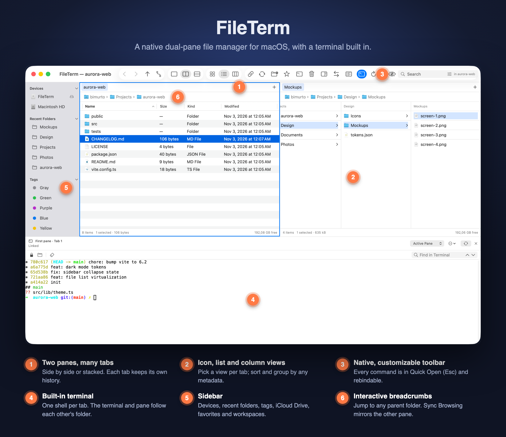
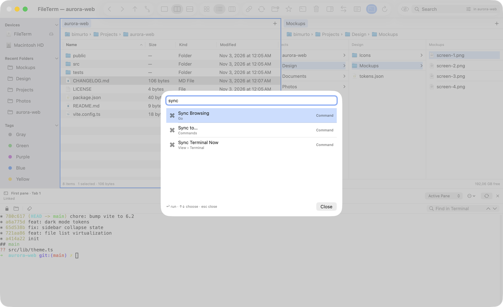

<div align="center">

# FileTerm

**A native dual-pane file manager for macOS, with a terminal built in.**


[Features](#features) · [Getting started](#getting-started) · [Keyboard shortcuts](#keyboard-shortcuts) · [User guide](docs/user-guide/README.md) · [Development](#development)



</div>

## Why FileTerm

Finder shows one folder at a time and keeps the shell in another app. FileTerm puts two folders side by side and a terminal underneath that follows the folder you're in. Copy, sync, rename and connect to servers without leaving the window.

## Features

**Browse**
- One pane, two side by side, or two stacked. Each pane has its own tabs and Back/Forward history.
- Icon, list and column views per tab, with sort and group by any metadata.
- Interactive breadcrumbs, Go to Folder, recent folders, and Sync Browsing to mirror the other pane.
- Sidebar with devices, recent folders, tags, iCloud Drive, favorites and saved workspaces.

**Built-in terminal**
- Docks below or to the right of the panes. Toggle with `⌃` `` ` ``.
- One shell per tab; switching tabs keeps scrollback and running programs.
- Pane and terminal follow each other's folder at an idle prompt (zsh, bash, fish).
- Color themes (Dracula, Nord, Solarized, Gruvbox and more) and iTerm2 scheme import.

**Work with files**
- Copy, move and Copy to… through a shared transfer queue with conflict policies, verification and logs.
- Batch Rename with ordered rules and a live Original → New preview.
- Sync two folders with a preview of every action before it runs.
- Compress and extract zip and tar archives, and browse archives as folders.
- Preview panel, Quick Look, Get Info, checksums, folder sizes and Copy Path formats.

**Connect**
- SFTP, FTP, FTP-TLS, WebDAV, Amazon S3, Backblaze B2, SMB, NFS and AFP. Passwords live in the Keychain.
- Edit remote files in your editor; FileTerm uploads on save.

**Stay on the keyboard**
- Quick Open (`Esc`) finds any command, folder, favorite or app by name.
- Every command can get a shortcut in Settings › Shortcuts.
- User-defined Tools run shell commands on the selection. Git Add, Commit, Push and Pull are built in.

<details>
<summary><b>Quick Open</b></summary>
<br>

</details>

Not built yet: Google Drive, OneDrive, Dropbox and Rackspace connections, iCloud sync of favorites, and resuming transfers after a restart. See [Limits and known gaps](docs/user-guide/13-limits-and-known-gaps.md).

## Getting started

There is no prebuilt release yet. Build from source:

Requirements: macOS 14+, Xcode 16+ (Swift 6). No Apple developer account needed.

1. Fetch the pinned tools and packages:

   ```sh
   bash scripts/fetch-dependencies.sh
   ```

2. Generate the Xcode project and open it:

   ```sh
   bash scripts/generate-project.sh
   open FileTerm.xcodeproj
   ```

3. Select **FileTerm → My Mac** and press **⌘R**.

First steps in the app:

1. Choose **View › Vertical — Side by Side** to get two panes.
2. Press **⌃`** to open the terminal. Type `cd ..` and watch the pane follow.
3. Press **Esc** and type a command name, for example `new tab`.

The [user guide](docs/user-guide/README.md) covers every feature in 13 chapters.

## Keyboard shortcuts

| Action | Shortcut |
|---|---|
| Quick Open (commands, folders, favorites) | `Esc` |
| Show/hide terminal | `⌃` `` ` `` |
| Move focus between pane and terminal | `⌃⌥` `` ` `` |
| Quick Select by name, extension or tag | `⌘S` |
| Find | `⌘F` |
| Quick Look | `⌘Y` |
| New tab / select tab 1–5 | `⌘T` / `⌘1`–`⌘5` |
| New folder / new file | `⇧⌘N` / `⌥⇧⌘N` |
| Refresh | `⌘R` |

Full list: [command reference](docs/user-guide/commands.md). Rebind any of them in Settings › Shortcuts.

## Development

### Build details

`project.yml` is the source of truth for the generated Xcode project. Regenerate after adding files or changing build settings. Do not edit downloaded packages.

`fetch-dependencies.sh` downloads XcodeGen 2.44.1, Defaults 8.2.0, Settings 3.1.1 and SwiftTerm into `.build/`. The XcodeGen archive is SHA-256 checked and package commits are checked before project generation. Nothing is installed system-wide.

### Keep folder permissions across rebuilds

An ad-hoc signature changes with every build, so macOS asks again for Desktop, Documents and Downloads. A local certificate keeps the signature stable:

1. In Keychain Access, choose **Certificate Assistant → Create a Certificate**. Name it `FileTerm Dev` and set the type to **Code Signing**.
2. Create `dev/Signing.local.xcconfig` (Git ignores it):

   ```
   CODE_SIGN_IDENTITY = FileTerm Dev
   ```

3. Rebuild, then grant the prompts one last time.

If the build can't find the identity, open the certificate in Keychain Access and set **Trust → Code Signing** to **Always Trust**.

### Create a DMG

```sh
bash scripts/create-dmg.sh
```

This writes `.build/FileTerm.dmg`. It isn't notarized, so Gatekeeper blocks it on other Macs.

### Tests

```sh
swift test
swift format lint --strict --recursive FileTerm FileTermCoreTests FileTermTests FileTermUITests Package.swift
xcodebuild -project FileTerm.xcodeproj -scheme FileTerm \
  -destination 'platform=macOS' -derivedDataPath .build/xcode test
```

- `swift test` runs the dependency-free core tests: filesystem operations, pane histories, tabs, session snapshots, sorting and grouping, navigation races, Sync Browsing and command availability.
- `xcodebuild … test` runs settings, navigation and device tests plus native UI tests. UI tests need an interactive desktop and Xcode's automation permission.
- CI runs the core tests, the native build and the settings tests. Run UI tests locally.
- For isolated runs, `FILETERM_INITIAL_DIRECTORY` overrides the starting folder and `FILETERM_SETTINGS_SUITE` selects a separate preferences domain.

If an agent environment blocks SwiftPM's nested sandbox, use `swift test --disable-sandbox`. Xcode builds may need the Xcode app when package-resolution services are blocked.

### Project structure

| Path | Contents |
|---|---|
| `FileTerm/Core` | Provider-neutral locations, async provider protocol, pane model, command registry, and feature logic (transfers, sync, rename, archives, connections) |
| `FileTerm/Core/Filesystem` | Local provider. File work runs in a dedicated actor with 64 KiB chunked reads and writes |
| `FileTerm/App`, `Commands`, `Views` | AppKit lifecycle and menus, SwiftUI views, native path control |
| `FileTerm/Services` | Coordinators that connect core logic to the UI: file operations, previews, remote editing, Git, tools |
| `FileTerm/Settings` | Defaults-backed settings and the Settings window panes |
| `FileTerm/Terminal` | SwiftTerm PTY sessions, temporary shell integration, terminal drawer |

### Roadmap

Work is planned in [milestones](docs/README.md). Open problems are tracked in [Known issues](docs/known-issues.md).

## Acknowledgements

Built with [SwiftTerm](https://github.com/migueldeicaza/SwiftTerm), [Defaults](https://github.com/sindresorhus/Defaults), [Settings](https://github.com/sindresorhus/Settings) and [XcodeGen](https://github.com/yonaskolb/XcodeGen).
