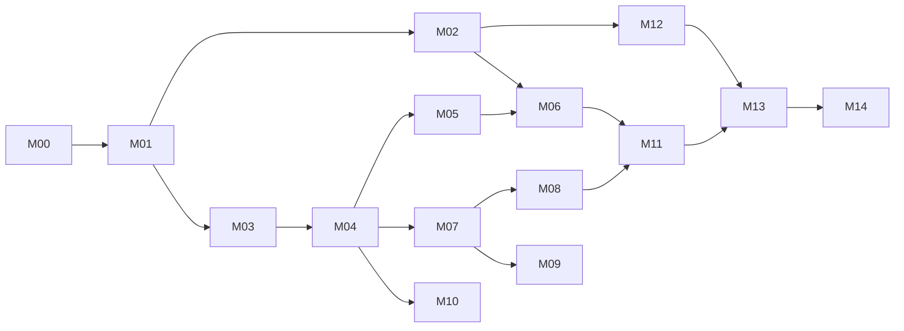

# file-term — Milestone Roadmap

This roadmap breaks [ForkLift_Features_and_Usage_Guide.md](../data/ForkLift_Features_and_Usage_Guide.md) (ForkLift 4.6 build 469) into milestones you can implement one at a time. Each milestone has its own file with small, testable work items.

## How to read the milestone files

- **Item ID** — `M<milestone>.<item>`, e.g. `M04.03`.
- **Scope** — what the item builds.
- **Acceptance criteria** — checkboxes that define "done".
- **Ref** — the chapter/section in the source guide.
- Items marked **(vendor-documented)** come from BinaryNights docs and were not tested in the installed app. Items marked **(post-4.6)** come from newer versions.

## Milestones

| # | Milestone | Source chapter | Depends on |
|---|-----------|----------------|------------|
| M00 | [Foundation & app shell](milestones/M00-foundation.md) | Intro sections | — |
| M01 | [Navigation & panes](milestones/M01-navigation-and-panes.md) | Ch. 1 | M00 |
| M02 | [Views, windows & tabs](milestones/M02-views-windows-tabs.md) | Ch. 2 | M01 |
| M03 | [Selection, search & quick commands](milestones/M03-selection-search-quick-commands.md) | Ch. 3 | M01 |
| M04 | [File creation, copying & moving](milestones/M04-file-operations.md) | Ch. 4 | M03 |
| M05 | [Metadata, preview & file utilities](milestones/M05-metadata-preview-utilities.md) | Ch. 5 | M04 |
| M06 | [Built-in terminal (follows pane directory)](milestones/M06-built-in-terminal.md) | New feature (not in guide) | M01, M02, M05 |
| M07 | [Transfers, activities & logs](milestones/M07-transfers-activities-logs.md) | Ch. 7 | M04 |
| M08 | [Connections & remote locations](milestones/M08-connections-remote.md) | Ch. 6 | M07 |
| M09 | [Synchronization & batch rename](milestones/M09-sync-and-batch-rename.md) | Ch. 8 | M07 |
| M10 | [Archives, deletion & comparison](milestones/M10-archives-deletion-comparison.md) | Ch. 9 | M04 |
| M11 | [Favorites, tools, editing & Git](milestones/M11-favorites-tools-editing-git.md) | Ch. 10 | M08 |
| M12 | [Appearance, settings & macOS integration](milestones/M12-appearance-settings-macos.md) | Ch. 11 | M02 |
| M13 | [Additional documented capabilities](milestones/M13-additional-capabilities.md) | Ch. 12 | M11, M12 |
| M14 | [Post-4.6 additions & release hardening](milestones/M14-post-4.6-and-hardening.md) | Ch. 12–13 | All |

> M07 (transfers) comes before M08 (connections) because remote protocols use the transfer queue, conflict policies and logging. Chapter 7 is therefore built before Chapter 6.

## Rules that apply to every milestone

1. Disabled commands must show *why* they are unavailable (no selection, single-pane only, wrong location type). See guide › Coverage limit.
2. Destructive actions (delete, overwrite, sync deletion, remote save) must ask for confirmation or offer a preview.
3. Every long-running operation must go through the Activities/Logs system once M07 exists.
4. Default shortcuts follow the installed 4.6 values listed in the items, and users can change them (M03.09).
